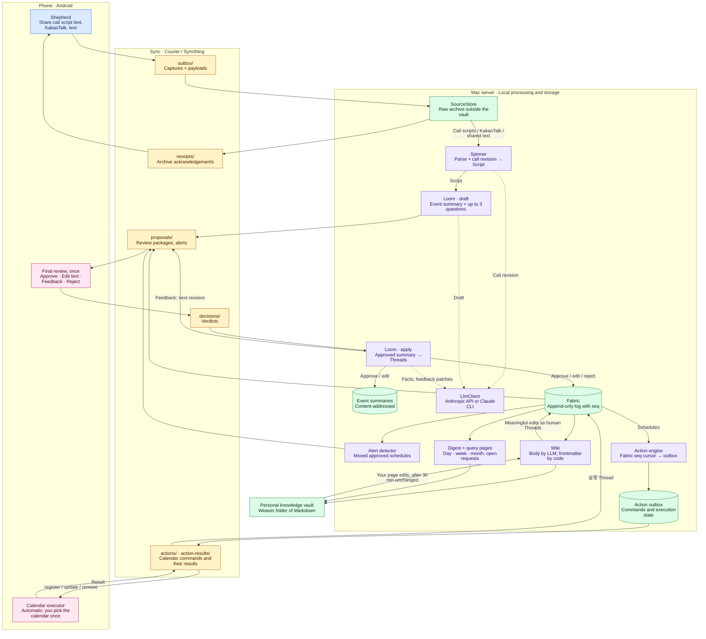

# Weaver

Turn everyday phone records into reviewed personal knowledge.

Weaver is a personal tool for collecting manually shared Galaxy call transcript
text, KakaoTalk exports, and shared text. A local Mac server parses the material
and uses an LLM to write one event summary per source. You review each summary
once on the phone; only approved summaries enter an append-only log, from which a
personal knowledge vault such as Obsidian is compiled.

**Code merged; real-device validation pending:** automated tests cover the
server workflow with fake LLMs and temporary paths. Follow the
[roadmap (#37)](https://github.com/JunHCha/weaver/issues/37).

## How it works

The names follow a weaving metaphor: **Shepherd** captures material on the phone,
**Courier** transports files through Syncthing, **Spinner** parses a source into a
Script, **Loom** drafts the event summary and applies your review, **Fabric** keeps
the approved facts as a log, and **Wiki** compiles that log into the vault.

The diagram shows the implemented flow; device-to-device validation is still
pending. Courier's four folders carry files in the directions shown; they are
transport routes, not the raw archive or the knowledge vault.



Call input is manually shared Galaxy recording transcript text (ADR-028).
Spinner does not invoke STT. LLM revision, drafting and extraction use external
APIs through the shared `LlmClient` boundary. Approving a summary records facts.
It does not authorize execution of requests found in the source material.

| Term | Meaning |
| --- | --- |
| Script | A source's parsed and polished text, with segments and provenance retained. |
| Event summary | The single document Loom drafts for one source (the review unit). The approved text is stored by its content hash. |
| Verdict | The review result for one exact revision: approve, edit the text, natural-language feedback, or reject. |
| Thread | One row of the Fabric log: an occurrence time, one sentence of content, tags, a kind (request, decision, schedule, record), source and actor. |
| Action | A command for the outside world (today: `calendar.register`, `calendar.update`, `calendar.remove`). It lives in the Action outbox, not in Fabric, because its execution state changes. |
| 실행 Thread | The recorded result of an Action (done, or given up, with the calendar event ID). It points at the Thread it executed with `executes`, and wiki, Digest and the data-flow map do not treat it as a business fact. |
| Fabric | The append-only log of approved or human-written Threads. The store assigns a monotonic `seq`; consumers read from a `seq` bookmark. Corrections add rows (a tag correction, a rejection) instead of rewriting history. |
| Wiki | The vault pages compiled from Fabric: the LLM writes each page body, code writes the frontmatter. |
| Digest | Generated day, week and month summaries with links back to their sources. |
| Query pages | Deterministic views such as open requests, upcoming deadlines and contacts by person. |
| Context dictionary | Names, aliases, known misrecognitions and kinds (person, organization, project, topic) used as drafting hints; it starts empty and learns the corrections you choose. |
| Fleece | Raw audio. Not collected in the current flow (ADR-028); the term is kept for the optional, unwired STT adapter. |

See the [JSON contracts](schema/README.md) for the wire formats and review rules.

## Your data at a glance

The Android first screen maps each item across **Shepherd · Spinner · Loom · Fabric · Wiki**
and **You**. Tap a node for its items or open **You** for pending approvals. Landscape
windows keep the map beside a right panel; portrait windows use a bottom sheet.
The map replays changes since the last visit once, with no live movement loop.

The server publishes additive progress observations under `proposals/pipeline/`;
existing archive receipts confirm Mac arrival. Today's Thread results, wiki pages
and Digest link back to each item. Select the phone's synchronized local vault and
enter its Obsidian name to enable page links after matching file bytes arrive.
See [the data flow map](docs/pipeline-map.md) for state and synchronization rules.

## Current status

Merged implementation:

- Resident server runtime with restart recovery and launchd management via
  `python -m weaver.app` subcommands `run`, `install-agent`, `uninstall-agent`,
  and `status`; Courier file handling and SourceStore archiving.
- Spinner text parsing, Galaxy call revision, persistent checkpoints and retries;
  Loom event summary drafting with bounded questions, one-time review
  (approve, edit, feedback, reject), content-addressed approved summaries and
  recoverable Thread extraction.
- Append-only SQLite Fabric with deterministic current-value projection;
  schedule change alerts and approved-schedule files for the phone.
- Wiki compilation with protected pages, human-edit capture (diffs are committed
  to a git directory outside the vault and meaningful changes become Threads),
  Digest and query pages, all disabled until `[wiki]` is configured.
- Android Shepherd call metadata and manual text sharing, Storage Access
  Framework (SAF) Courier transport, review and change-alert notifications, one
  review screen (summary first, choice questions, processing steps), a Glance
  widget, a data flow home map with per-item progress and result links, and
  approved schedule registration through CalendarContract with
  interruption recovery.
- Offline summary evaluation replay and server E2E smoke tests.

The code is merged, but the full flow connecting a real Galaxy Fold,
Syncthing, and a real LLM has **not been validated**. Validation so far is limited
to automated tests using fake LLMs and temporary paths. Call input uses manually
shared Galaxy transcript text; the optional local STT adapter remains in the
code but is not connected to Spinner. Syncthing setup research
([#19](https://github.com/JunHCha/weaver/issues/19)) remains open; audio-file
cleanup ([#32](https://github.com/JunHCha/weaver/issues/32)) is deferred.

## Repository and stack

| Path | Contents |
| --- | --- |
| [server/](server/) | Python server modules and tests. |
| [android/](android/) | Android app and contract tests. |
| [schema/](schema/) | Generated JSON Schemas and synthetic examples. |
| [.github/workflows/](.github/workflows/) | Manual and release verification. |

- **Server:** Python 3.12+, uv, Typer, SQLite, Ruff, and strict mypy.
- **Speech (optional):** the local MLX Whisper `large-v3-turbo` adapter remains
  available through the `stt` installation extra on Apple Silicon, but is not
  wired into Spinner. It requires model preparation and `ffmpeg`, and does not
  identify speakers.
- **LLM:** A shared `LlmClient` boundary with an Anthropic Claude adapter today;
  [more backends are planned (#46)](https://github.com/JunHCha/weaver/issues/46).
- **Android:** Kotlin, Jetpack Compose, kotlinx.serialization; minSdk 26,
  compileSdk and targetSdk 36.
- **Transport:** Syncthing between devices, with Syncthing-Fork selected for
  Android. Device setup and end-to-end transport testing remain separate from
  the Courier module tests.

## Development quick start

For the server, install Python 3.12+ and uv. Run from the repository root:

```sh
uv sync --project server --locked
uv run --project server python -c 'import weaver'
uv run --project server python -m weaver.app --help
uv run --project server pytest
uv run --project server ruff check server
uv run --project server ruff format --check server
uv run --project server mypy server/src
```

For Android, install JDK 21 and an Android SDK with `platforms;android-36`.
Set `ANDROID_HOME` or configure `android/local.properties`, then run:

```sh
cd android
./gradlew assembleDebug lint testDebugUnitTest
```

When changing contracts, regenerate the schemas and update the handwritten
Kotlin models in the same change. See [schema/README.md](schema/README.md) for
export commands and [AGENTS.md](AGENTS.md) for development conventions.

## Tests and CI

Tests must not access real LLMs, speech models, or user vaults. PR validation
relies on passing local checks before opening the PR.

The [CI workflow](.github/workflows/ci.yml) runs full verification only through
manual `workflow_dispatch` or release tag pushes matching `v*`. Pull requests,
branch pushes, and schedules do not trigger CI. It checks the server on Ubuntu
and macOS arm64, the offline summary evaluation replay, schema export freshness, and
Android lint, unit tests, and the debug build. The macOS job verifies
compatibility, not STT performance.

## Privacy principles

- Keep raw sources in local storage outside the vault. Sync only the four Courier
  folders for transport; keep archives, server state, and credentials separate.
  To open generated pages on the phone, separately share the intended vault
  through Syncthing and grant Weaver read access to its local folder.
- Centralize LLM calls in `LlmClient`. The current input is text, not raw audio;
  text sent for revision, drafting and extraction leaves the device. Call revision sends
  speech segments from the shared transcript. Automatic redaction is not provided.
- Require human review before extracted facts reach Fabric and the vault.
- Keep API keys, signing keys, passwords, and personal configuration out of git.

The wiki is disabled by default. To enable periodic compilation, add the
following to `server.toml` (paths are relative to the configuration file):

```toml
[wiki]
enabled = true
# vault_root = "vault" # optional; defaults to the top-level vault_root
folder = "Weaver"
timezone = "Asia/Seoul"
settle_seconds = 1800
interval_seconds = 60
```

The settle period protects recent human edits; pending pages are retried on a
later wiki interval. Keep the state directory outside the wiki vault.

Start at `Weaver/index.md`. Wiki generation reads the complete Fabric snapshot and
approved summaries in one structured LLM call, organizing pages around projects,
operations and reusable knowledge rather than creating a page for every tag.
`schema.md` records the operating rules; `log.md` records the latest compilation
sequence and any explicitly excluded evidence. Existing human page edits remain
protected, and rebuilding the wiki does not re-extract or rewrite Fabric facts.

Source summaries use Obsidian-safe filenames. When a source title changes, the
server repairs links and retires its old summary copy and restoration record;
pending human edits are preserved for a later retry.

Wiki edits also appear on the map as teal items with a **Wiki → Fabric → Wiki**
route and change/Thread/result details. They do not create capture receipts or
approval tasks. The server reports committed updates; the Android app separately
checks arrival in the phone's synchronized vault before opening a result.

### 서버 웹 UI

`pnpm --dir web install --frozen-lockfile && pnpm --dir web build` 후
`uv run --project server python -m weaver.app web --config /path/to/config.toml`을
실행하면 `http://127.0.0.1:8765`에서 Fabric·Spinner·Loom을 읽기 전용으로
확인할 수 있습니다. `weaver web`은 loopback 호스트만 허용하며 쓰기 API가
없습니다. `--port`, `--static-dir` 또는 `WEAVER_WEB_DIR`로 포트와 정적 파일
위치를 지정할 수 있고, 빌드가 없으면 경고와 함께 API만 제공합니다.

### 폰 전용 HTTPS API (Tailscale)

폰이 Syncthing 없이 Mac(또는 개인 서버)에 직접 접속하는 `/mobile/v1` API다
([ADR-040](docs/domain/decisions/040-tailscale-courier-http-transport.md)).
`weaver web`(loopback)과 별개의 리스너·앱이며 세션 토큰을 공유하지 않는다.
서버 위치는 Mac이든 개인 클라우드든 상관없고, 폰에는 서버 주소 하나만 설정한다.

**1. 설정.** `[mobile]`에 이 서버의 tailnet 주소를 적는다. 와일드카드(`0.0.0.0`, `::`)와
LAN 주소는 설정 오류이며, 주소를 비워 두면 API는 꺼진 채다.

```toml
[mobile]
bind = "100.106.199.83"      # 이 서버의 tailnet IP (100.64.0.0/10 또는 fd7a:115c:a1e0::/48)
port = 8787
whois = "cli"                # 기본: `tailscale whois --json`(App Store판 앱 번들 CLI 자동 사용). "localapi"는 소켓이 있는 배포판용
# tailscale_cli = "/Applications/Tailscale.app/Contents/MacOS/Tailscale"
# whois_socket = "/var/run/tailscaled.socket"   # localapi일 때
transport = "files"          # 기본값: Syncthing 경로 유지. "http"면 폰 HTTP 경로
[mobile.features]            # 선택: 기능별로 덮어쓰기 (capture, review, action)
# action = "http"
```

tailnet ACL에서 폰 → 서버 `tcp:8787`만 허용한다. tailscaled가 꺼졌거나 주소가 바뀌면
리스너는 시작하지 않고(닫힌 채 실패) 와일드카드로 대체하지 않는다.

**2. 실행.** 데몬(`weaver run`)과 별도 프로세스로 API를 띄운다. 데몬은 접수된
Verdict·ActionResult를 기존 도메인 journal로 적용하므로 둘 다 떠 있어야 한다.

```sh
uv run --project server python -m weaver.app mobile serve --config server.toml
```

첫 실행이나 `pair`가 `state_root/mobile/tls/`에 로컬 CA와 서버 인증서를 만든다
(0600, CA 10년·서버 인증서 1년). 공개 인증서(ts.net)를 쓰지 않으므로 기기 이름이
CT 로그에 올라가지 않는다. tailnet IP가 바뀌면 `mobile cert`가 같은 CA로 서버
인증서만 다시 발급하므로 폰은 다시 신뢰할 필요가 없다. 평문 HTTP나 인증서 검증
해제 경로는 없다.

**3. 페어링.** 네트워크로 토큰을 발급하는 엔드포인트는 없다. Mac에서 CLI로 발급하고
QR로 폰에 전달한다. 토큰(256비트)은 이때 한 번만 보이며 서버에는 해시만 남는다.

```sh
# 폰의 tailnet IP로 node ID를 whois에서 가져오거나, --node-id 로 직접 지정
uv run --project server python -m weaver.app mobile pair --label fold --phone-ip 100.108.10.0 --executor   # QR만 출력
uv run --project server python -m weaver.app mobile devices
uv run --project server python -m weaver.app mobile revoke dev_...   # 분실·교체 시 철회
```

`--scope`로 `read`·`capture`·`review`·`action`·`edit` 권한을 나눈다(기본 `read capture
review edit`, `--executor`면 `action` 추가). QR에는 서버 주소, token, 로컬 CA 인증서가
들어 있고(폰은 leaf가 아니라 CA를 고정한다), payload 텍스트는 `--print-json`을 줄 때만 출력한다. Action 실행 폰은 한 대로 고정되며, 교체하려면 기존 기기를 `revoke`한 뒤 새로
`pair --executor` 한다(자동 이전 없음). 모든 요청은 (1) tailscaled whois로 실제 소켓
peer를 확인해 등록된 node와 대조하고(확인 불가면 거부), (2) 그 node에 묶인 앱 토큰을
확인한다. 브라우저 `Origin`, 다른 `Host`, CORS, 쿠키는 허용하지 않는다.

**4. 전송 경로와 복귀.** `transport`(또는 `[mobile.features]`)가 기능별 쓰기 경로를
고른다. 설정을 바꾼 뒤 데몬을 재시작하면(또는 `mobile reconcile`) 적용된다.

- `capture`: 폰이 업로드한 capture는 파일 경로와 같은 archive에 들어간다. 어느 경로로
  보내든 늦게 도착한 재전송은 같은 capture ID·sha로 흡수된다.
- `review`: HTTP로 온 Verdict는 파일 경로와 같은 결정 journal로 한 번만 적용된다.
- `action`: `http`일 때만 `GET /actions`가 Action을 내려 주고 `actions/` 폴더는 비워 둔다
  (실행기 두 대가 같은 Action을 받지 않게 하려는 것이다). `files`로 돌아오면 outbox의
  미결 Action을 폴더에 다시 게시한다. 이미 보낸 결과는 어느 경로로 늦게 와도 한 번만
  반영된다.

`http → files` 복귀 절차: ① `transport = "files"`(또는 기능별 값)로 바꾸고 ② 데몬을
재시작하거나 `mobile reconcile`을 실행한다. 미결 검토 패키지는 `proposals/`에, 미결
Action은 `actions/`에 다시 게시된다. ③ 폰 앱도 파일 경로로 바꾼다. 폰이 보낸 뒤 응답을 받지
못한 capture·Verdict·결과는 원래 ID로 다시 보내도 공통 journal이 중복을 막는다.
`mobile status`가 기능별 설정값·기록값과 미결 작업 수를 보여 준다.

**재시작 순서.** 설정을 바꾼 뒤 `files → http`는 데몬 → `mobile serve`, `http → files`는 `mobile serve` → 데몬 순으로
재시작한다(실행기 중복 방지; 이유는 mobile README의 "전송 전환 시 재시작 순서").

로그에는 불투명 ID와 오류 코드만 남긴다. 계약 상세와 한계는
[`server/src/weaver/mobile/README.md`](server/src/weaver/mobile/README.md)에 있다.

### CLI LLM 제한 시간과 재시도

[`server/config.example.toml`](server/config.example.toml)의 `[llm]`에서
Claude CLI와 Codex CLI의 제한 시간을 설정한다.

```toml
[llm]
backend = "codex_cli" # 또는 "claude_cli"
cli_timeout_seconds = 300
wiki_cli_timeout_seconds = 600
max_cli_calls_per_day = 30
```

두 제한 시간은 초 단위이며 0보다 크고 900 이하여야 한다. 일반 호출은 기본
300초, `wiki.compile_batch`·`wiki.digest` 등 `wiki.*` 호출은 기본 600초를 쓴다.
API 백엔드는 기존 120초 제한과 예산 규칙을 유지한다.

소스 정리와 Wiki 작업이 연속으로 시간 초과되면 각 작업의 재시도 간격을
기본 주기의 2배, 4배, 8배로 늘리며 최대 1시간을 기다린다. 성공하면 초기화한다.
다른 오류가 끼어도 소스의 대기 간격은 줄어들지 않으며, Wiki의 시간 초과
백오프도 성공할 때까지 유지한다.
소스별 대기 시각과 연속 시간 초과 횟수는 재시작 뒤에도 유지하고, Wiki의
재시도 간격은 프로세스 안에서 관리한다. 소스의 기존 최대 20회 재시도 규칙은 유지한다.

두 CLI가 공유하는 일일 호출 한도의 절반 이상을 시간 초과로 사용하면 그날의
Wiki CLI 호출을 중지한다. 예를 들어 한도가 30이면 시간 초과 15회부터 중지하며,
홀수 한도는 올림한다. 이 집계에는 소스 호출의 시간 초과와 **배포 전에 오늘
이미 기록된 CLI 시간 초과**도 포함한다. 차단 중에는 Wiki 컴파일을 건너뛰며
호출 ledger 행을 추가하지 않고 차단 경고는 하루 한 번만 남긴다. 집계는
`state_root/llm.sqlite3`에 보관해 재시작 뒤에도 적용하며, 호출을 시작한 서버 현지
날짜를 기준으로 다음 날 다시 허용한다. 소스 처리는 남은 일일 한도 안에서 계속한다.
경고 로그에는 원문·프롬프트·응답을 남기지 않는다.

Codex 시간 초과 경고에는 마지막 `--json` 이벤트 유형(`last_event`), 경과 초,
이벤트 스트림 크기(`stdout_bytes`), 최종 출력 파일 크기(`output_bytes`),
직렬화한 입력과 스키마 크기(`input_bytes`, `schema_bytes`)를 남긴다.
같은 수치를 호출 ledger의 `timeout_diagnostics`에도 저장한다. 이벤트 이름은
허용 목록으로 제한하고 알 수 없는 유형은 `unknown`, 이벤트가 없으면 `none`으로
기록한다. 이 수치는 입력·스키마 규모와 마지막으로 관찰한 진행 단계를 보여주며,
모델 내부 추론이나 스키마 처리 중 어느 쪽이 원인인지를 확정하지는 않는다.

상주 서버의 SIGTERM·SIGINT 종료 요청은 실행 중인 CLI에도 전달한다. runner는
종료 이벤트를 확인해 자식 프로세스 그룹을 종료하고 회수하며, Codex 임시 폴더도
정리한다. 중단은 시간 초과나 소스 실패로 집계하지 않는다.
