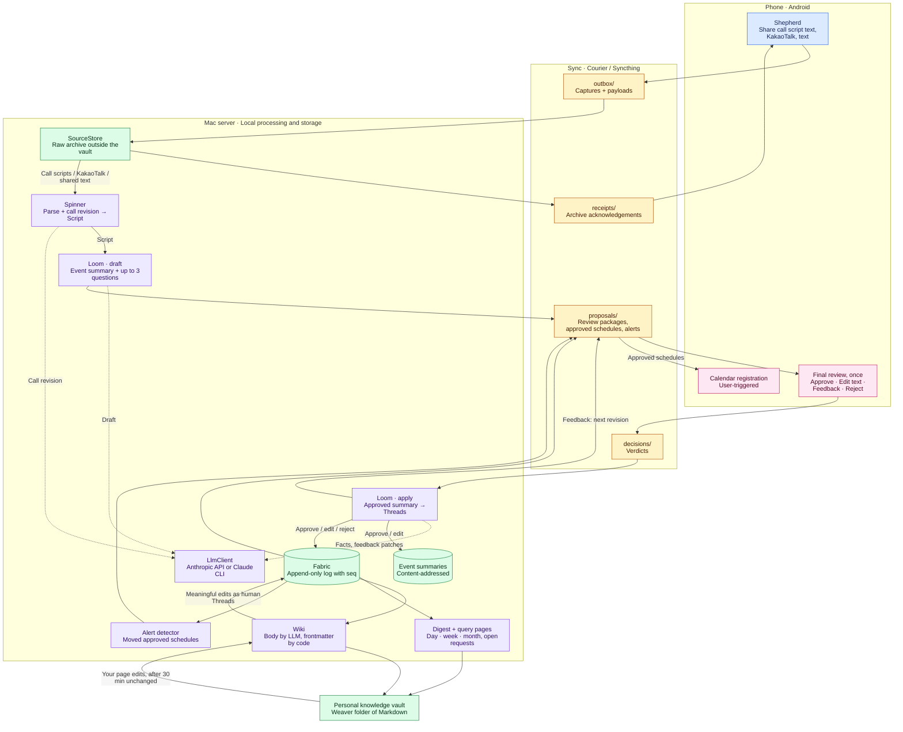

# Weaver

Turn everyday phone records into reviewed personal knowledge.

Weaver is a personal tool for collecting manually shared Galaxy call transcript
text, KakaoTalk exports, and shared text. A local Mac server parses the material
and uses an LLM to write one event summary per source. You review each summary
once on the phone; only approved summaries enter an append-only log, from which a
personal knowledge vault such as Obsidian is compiled.

**Code merged; real-device validation pending:** automated tests cover the
server workflow with fake LLMs and temporary paths. Follow the
[roadmap (#37)](https://github.com/JunHCha/weaver/issues/37).

## How it works

The names follow a weaving metaphor: **Shepherd** captures material on the phone,
**Courier** transports files through Syncthing, **Spinner** parses a source into a
Script, **Loom** drafts the event summary and applies your review, **Fabric** keeps
the approved facts as a log, and **Wiki** compiles that log into the vault.

The diagram shows the implemented flow; device-to-device validation is still
pending. Courier's four folders carry files in the directions shown; they are
transport routes, not the raw archive or the knowledge vault.



Call input is manually shared Galaxy recording transcript text (ADR-028).
Spinner does not invoke STT. LLM revision, drafting and extraction use external
APIs through the shared `LlmClient` boundary. Approving a summary records facts.
It does not authorize execution of requests found in the source material.

| Term | Meaning |
| --- | --- |
| Script | A source's parsed and polished text, with segments and provenance retained. |
| Event summary | The single document Loom drafts for one source (the review unit). The approved text is stored by its content hash. |
| Verdict | The review result for one exact revision: approve, edit the text, natural-language feedback, or reject. |
| Thread | One row of the Fabric log: an occurrence time, one sentence of content, tags, a kind (request, decision, schedule, record), source and actor. |
| Fabric | The append-only log of approved or human-written Threads. The store assigns a monotonic `seq`; consumers read from a `seq` bookmark. Corrections add rows (a tag correction, a rejection) instead of rewriting history. |
| Wiki | The vault pages compiled from Fabric: the LLM writes each page body, code writes the frontmatter. |
| Digest | Generated day, week and month summaries with links back to their sources. |
| Query pages | Deterministic views such as open requests, upcoming deadlines and contacts by person. |
| Context dictionary | Names, aliases, known misrecognitions and kinds (person, organization, project, topic) used as drafting hints; it starts empty and learns the corrections you choose. |
| Fleece | Raw audio. Not collected in the current flow (ADR-028); the term is kept for the optional, unwired STT adapter. |

See the [JSON contracts](schema/README.md) for the wire formats and review rules.

## Your data at a glance

The Android first screen maps each item across **양치기 · 물레 · 베틀 · 천 · 위키**
and **나**. Tap a node for its items or open **나** for pending approvals. Landscape
windows keep the map beside a right panel; portrait windows use a bottom sheet.
The map replays changes since the last visit once, with no live movement loop.

The server publishes additive progress observations under `proposals/pipeline/`;
existing archive receipts confirm Mac arrival. Today's Thread results, wiki pages
and Digest link back to each item. Select the phone's synchronized local vault and
enter its Obsidian name to enable page links after matching file bytes arrive.
See [the data flow map](docs/pipeline-map.md) for state and synchronization rules.

## Current status

Merged implementation:

- Resident server runtime with restart recovery and launchd management via
  `python -m weaver.app` subcommands `run`, `install-agent`, `uninstall-agent`,
  and `status`; Courier file handling and SourceStore archiving.
- Spinner text parsing, Galaxy call revision, persistent checkpoints and retries;
  Loom event summary drafting with bounded questions, one-time review
  (approve, edit, feedback, reject), content-addressed approved summaries and
  recoverable Thread extraction.
- Append-only SQLite Fabric with deterministic current-value projection;
  schedule change alerts and approved-schedule files for the phone.
- Wiki compilation with protected pages, human-edit capture (diffs are committed
  to a git directory outside the vault and meaningful changes become Threads),
  Digest and query pages, all disabled until `[wiki]` is configured.
- Android Shepherd call metadata and manual text sharing, Storage Access
  Framework (SAF) Courier transport, review and change-alert notifications, one
  review screen (summary first, choice questions, processing steps), a Glance
  widget, a data flow home map with per-item progress and result links, and
  approved schedule registration through CalendarContract with
  interruption recovery.
- Offline summary evaluation replay and server E2E smoke tests.

The code is merged, but the full flow connecting a real Galaxy Fold,
Syncthing, and a real LLM has **not been validated**. Validation so far is limited
to automated tests using fake LLMs and temporary paths. Call input uses manually
shared Galaxy transcript text; the optional local STT adapter remains in the
code but is not connected to Spinner. Syncthing setup research
([#19](https://github.com/JunHCha/weaver/issues/19)) remains open; audio-file
cleanup ([#32](https://github.com/JunHCha/weaver/issues/32)) is deferred.

## Repository and stack

| Path | Contents |
| --- | --- |
| [server/](server/) | Python server modules and tests. |
| [android/](android/) | Android app and contract tests. |
| [schema/](schema/) | Generated JSON Schemas and synthetic examples. |
| [.github/workflows/](.github/workflows/) | Manual and release verification. |

- **Server:** Python 3.12+, uv, Typer, SQLite, Ruff, and strict mypy.
- **Speech (optional):** the local MLX Whisper `large-v3-turbo` adapter remains
  available through the `stt` installation extra on Apple Silicon, but is not
  wired into Spinner. It requires model preparation and `ffmpeg`, and does not
  identify speakers.
- **LLM:** A shared `LlmClient` boundary with an Anthropic Claude adapter today;
  [more backends are planned (#46)](https://github.com/JunHCha/weaver/issues/46).
- **Android:** Kotlin, Jetpack Compose, kotlinx.serialization; minSdk 26,
  compileSdk and targetSdk 36.
- **Transport:** Syncthing between devices, with Syncthing-Fork selected for
  Android. Device setup and end-to-end transport testing remain separate from
  the Courier module tests.

## Development quick start

For the server, install Python 3.12+ and uv. Run from the repository root:

```sh
uv sync --project server --locked
uv run --project server python -c 'import weaver'
uv run --project server python -m weaver.app --help
uv run --project server pytest
uv run --project server ruff check server
uv run --project server ruff format --check server
uv run --project server mypy server/src
```

For Android, install JDK 21 and an Android SDK with `platforms;android-36`.
Set `ANDROID_HOME` or configure `android/local.properties`, then run:

```sh
cd android
./gradlew assembleDebug lint testDebugUnitTest
```

When changing contracts, regenerate the schemas and update the handwritten
Kotlin models in the same change. See [schema/README.md](schema/README.md) for
export commands and [AGENTS.md](AGENTS.md) for development conventions.

## Tests and CI

Tests must not access real LLMs, speech models, or user vaults. PR validation
relies on passing local checks before opening the PR.

The [CI workflow](.github/workflows/ci.yml) runs full verification only through
manual `workflow_dispatch` or release tag pushes matching `v*`. Pull requests,
branch pushes, and schedules do not trigger CI. It checks the server on Ubuntu
and macOS arm64, the offline summary evaluation replay, schema export freshness, and
Android lint, unit tests, and the debug build. The macOS job verifies
compatibility, not STT performance.

## Privacy principles

- Keep raw sources in local storage outside the vault. Sync only the four Courier
  folders for transport; keep archives, server state, and credentials separate.
  To open generated pages on the phone, separately share the intended vault
  through Syncthing and grant Weaver read access to its local folder.
- Centralize LLM calls in `LlmClient`. The current input is text, not raw audio;
  text sent for revision, drafting and extraction leaves the device. Call revision sends
  speech segments from the shared transcript. Automatic redaction is not provided.
- Require human review before extracted facts reach Fabric and the vault.
- Keep API keys, signing keys, passwords, and personal configuration out of git.

The wiki is disabled by default. To enable periodic compilation, add the
following to `server.toml` (paths are relative to the configuration file):

```toml
[wiki]
enabled = true
# vault_root = "vault" # optional; defaults to the top-level vault_root
folder = "Weaver"
timezone = "Asia/Seoul"
settle_seconds = 1800
interval_seconds = 60
```

The settle period protects recent human edits; pending pages are retried on a
later wiki interval. Keep the state directory outside the wiki vault.
