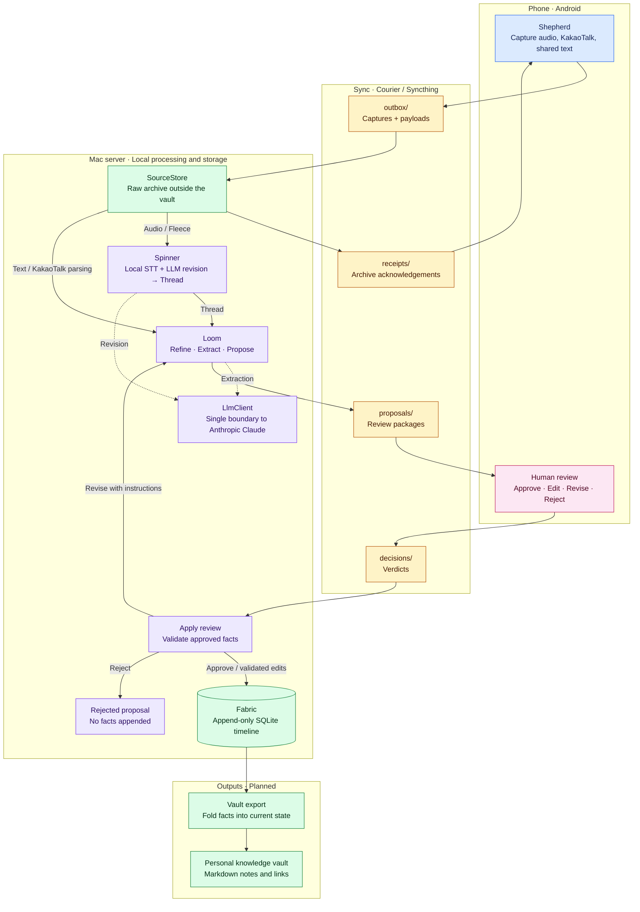

# Weaver

Turn everyday phone records into reviewed personal knowledge.

Weaver is a personal tool being built to collect call recordings, voice memos,
KakaoTalk exports, and shared text. A local Mac server transcribes audio and
organizes the material, using an LLM for revision and extraction. Human review
comes before proposed facts enter a central timeline log and are exported to a
personal knowledge vault such as Obsidian.

**MVP in progress:** the foundation modules are implemented; the complete capture,
processing, review, and export workflow is still being assembled. Follow the
[MVP roadmap (#37)](https://github.com/JunHCha/weaver/issues/37).

## How it works

The names follow a weaving metaphor: **Shepherd** captures material on the phone,
**Courier** transports files through Syncthing, **Spinner** turns audio into text,
**Loom** prepares and applies reviewed proposals, and **Fabric** preserves the
resulting facts before vault export.

The diagram shows the intended workflow, including components still planned.
Courier's four folders carry files in the directions shown; they are transport
routes, not the raw archive or the knowledge vault.



STT runs locally; LLM revision and extraction use an external Anthropic API.
Approving a proposal records facts. It does not authorize execution of requests
found in the source material.

| Term | Meaning |
| --- | --- |
| Fleece | Raw audio, such as a call recording or voice memo. |
| Thread | A source's text, with segments and provenance retained. |
| Proposal | A reviewable bundle of proposed entities, relations, schedules, and fact drafts from one source. |
| Verdict | The review result: approve, edit, revise with instructions, or reject. |
| Entry | One recorded fact in Fabric, with time, source, actor, and entity references. |
| Fabric | The central append-only log; corrections add facts rather than overwrite history. |

See the [v1 JSON contracts](schema/README.md) for the wire formats and review rules.

## Current status

Implemented foundations:

- Server package, Typer CLI scaffold, configuration, and v1 schemas.
- Server Courier file handling and SourceStore raw archiving.
- Anthropic `LlmClient` and local MLX `Stt` adapter.
- SQLite Fabric storage for append-only Entries and queries.
- Android app scaffold, schema models, and a Storage Access Framework (SAF)
  Courier client with diagnostics.
- Release/manual CI for server and Android verification.

In progress or planned: capture automation, KakaoTalk parsing, Spinner revision
orchestration, refinement rules, extraction and proposal generation, the human
review interface and Verdict handling, state folding, and vault export.
The server CLI currently validates configuration and initializes directories;
its resident processing runtime is not implemented yet. The Android Courier
client is a foundation for the planned capture and review experience.

## Repository and stack

| Path | Contents |
| --- | --- |
| [server/](server/) | Python server modules and tests. |
| [android/](android/) | Android app and contract tests. |
| [schema/](schema/) | Generated v1 JSON Schemas and synthetic examples. |
| [.github/workflows/](.github/workflows/) | Manual and release verification. |

- **Server:** Python 3.12+, uv, Typer, SQLite, Ruff, and strict mypy.
- **Speech:** MLX Whisper `large-v3-turbo` on Apple Silicon; local model
  preparation and `ffmpeg` are required for real transcription. The MVP adapter
  does not identify speakers.
- **LLM:** Anthropic Claude through a shared `LlmClient` boundary.
- **Android:** Kotlin, Jetpack Compose, kotlinx.serialization; minSdk 26,
  compileSdk and targetSdk 36.
- **Transport:** Syncthing between devices, with Syncthing-Fork selected for
  Android. Device setup and end-to-end transport testing remain separate from
  the Courier module tests.

## Development quick start

For the server, install Python 3.12+ and uv. Run from the repository root:

```sh
uv sync --project server --locked
uv run --project server python -c 'import weaver'
uv run --project server python -m weaver.app --help
uv run --project server pytest
uv run --project server ruff check server
uv run --project server ruff format --check server
uv run --project server mypy server/src
```

For Android, install JDK 21 and an Android SDK with `platforms;android-36`.
Set `ANDROID_HOME` or configure `android/local.properties`, then run:

```sh
cd android
./gradlew assembleDebug lint testDebugUnitTest
```

When changing contracts, regenerate the schemas and update the handwritten
Kotlin models in the same change. See [schema/README.md](schema/README.md) for
export commands and [AGENTS.md](AGENTS.md) for development conventions.

## Tests and CI

Tests must not access real LLMs, speech models, or user vaults. PR validation
relies on passing local checks before opening the PR.

The [CI workflow](.github/workflows/ci.yml) runs full verification only through
manual `workflow_dispatch` or release tag pushes matching `v*`. Pull requests,
branch pushes, and schedules do not trigger CI. It checks the server on Ubuntu
and macOS arm64, schema export freshness, and Android lint, unit tests, and the
debug build. The macOS job verifies compatibility, not STT performance.

## Privacy principles

- Keep raw sources in local storage outside the vault. Sync only the four Courier
  folders; keep archives, server state, the vault, and credentials separate.
- Centralize LLM calls in `LlmClient`. Audio transcription is local, but text sent
  for LLM processing leaves the device; the planned revision step sends the full
  transcript. Automatic redaction is outside the MVP scope.
- Require human review before proposed facts reach Fabric and vault export.
- Keep API keys, signing keys, passwords, and personal configuration out of git.
