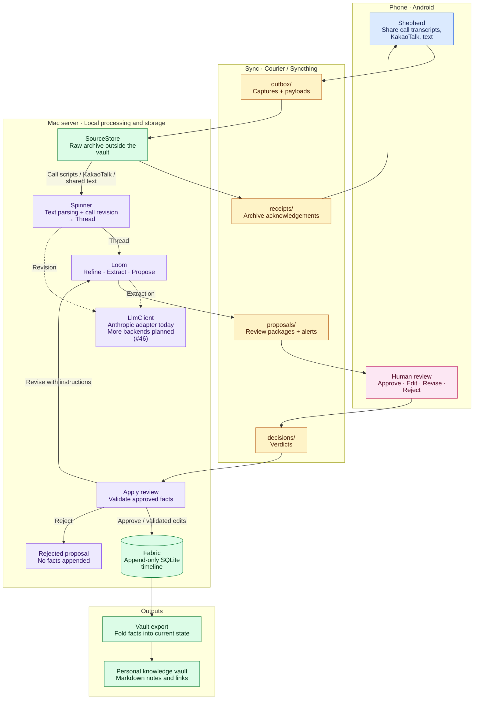

# Weaver

Turn everyday phone records into reviewed personal knowledge.

Weaver is a personal tool for collecting manually shared Galaxy call transcript
text, KakaoTalk exports, and shared text. A local Mac server parses the material
and uses an LLM for revision and extraction, with human review before proposed
facts enter a central timeline log and are exported to a personal knowledge
vault such as Obsidian.

**MVP code merged; real-device validation pending:** automated tests cover the
server workflow with fake LLMs and temporary paths. Follow the
[MVP roadmap (#37)](https://github.com/JunHCha/weaver/issues/37).

## How it works

The names follow a weaving metaphor: **Shepherd** captures material on the phone,
**Courier** transports files through Syncthing, **Spinner** parses text into Threads,
**Loom** prepares and applies reviewed proposals, and **Fabric** preserves the
resulting facts before vault export.

The diagram shows the implemented text workflow; device-to-device validation
is still pending.
Courier's four folders carry files in the directions shown; they are transport
routes, not the raw archive or the knowledge vault.



Call input is manually shared Galaxy recording transcript text (ADR-028).
Spinner does not invoke STT. LLM revision and extraction use external APIs
through the shared `LlmClient` boundary.
Approving a proposal records facts. It does not authorize execution of requests
found in the source material.

| Term | Meaning |
| --- | --- |
| Fleece | Raw audio, such as a call recording or voice memo. |
| Thread | A source's text, with segments and provenance retained. |
| Proposal | A reviewable bundle of proposed entities, relations, schedules, and fact drafts from one source. |
| Verdict | The review result: approve, edit, revise with instructions, or reject. |
| Entry | One recorded fact in Fabric, with time, source, actor, and entity references. |
| Fabric | The central append-only log; corrections add facts rather than overwrite history. |

See the [v1 JSON contracts](schema/README.md) for the wire formats and review rules.

## Current status

Merged MVP implementation:

- Resident server runtime with restart recovery and launchd management via
  `python -m weaver.app` subcommands `run`, `install-agent`, `uninstall-agent`,
  and `status`; Courier file handling and SourceStore archiving.
- Spinner text parsing, Galaxy call revision, persistent checkpoints and retries;
  refinement, LLM extraction, Proposer, and recoverable VerdictHandler.
- Append-only SQLite Fabric and current-state calculation; schedule change alerts.
- Publisher Markdown export into the vault's AI folder and OutputWatcher tracking
  of supported frontmatter edits in user copies outside that folder.
- Android Shepherd call metadata and manual text sharing, Storage Access Framework
  (SAF) Courier transport, proposal and change-alert notifications, review screens,
  a Glance widget, and approved schedule registration through CalendarContract
  with interruption recovery.
- Evaluation runner, offline regression baseline, and server E2E smoke tests.

The MVP code is merged, but the full flow connecting a real Galaxy Fold,
Syncthing, and a real LLM has **not been validated**. Validation so far is limited
to automated tests using fake LLMs and temporary paths. Call input uses manually
shared Galaxy transcript text; the optional local STT adapter remains in the
code but is not connected to Spinner. Syncthing setup research
([#19](https://github.com/JunHCha/weaver/issues/19)) remains open; audio-file
cleanup ([#32](https://github.com/JunHCha/weaver/issues/32)) is deferred.

## Repository and stack

| Path | Contents |
| --- | --- |
| [server/](server/) | Python server modules and tests. |
| [android/](android/) | Android app and contract tests. |
| [schema/](schema/) | Generated v1 JSON Schemas and synthetic examples. |
| [.github/workflows/](.github/workflows/) | Manual and release verification. |

- **Server:** Python 3.12+, uv, Typer, SQLite, Ruff, and strict mypy.
- **Speech (optional):** the local MLX Whisper `large-v3-turbo` adapter remains
  available through the `stt` installation extra on Apple Silicon, but is not
  wired into Spinner. It requires model preparation and `ffmpeg`, and does not
  identify speakers.
- **LLM:** A shared `LlmClient` boundary with an Anthropic Claude adapter today;
  [more backends are planned (#46)](https://github.com/JunHCha/weaver/issues/46).
- **Android:** Kotlin, Jetpack Compose, kotlinx.serialization; minSdk 26,
  compileSdk and targetSdk 36.
- **Transport:** Syncthing between devices, with Syncthing-Fork selected for
  Android. Device setup and end-to-end transport testing remain separate from
  the Courier module tests.

## Development quick start

For the server, install Python 3.12+ and uv. Run from the repository root:

```sh
uv sync --project server --locked
uv run --project server python -c 'import weaver'
uv run --project server python -m weaver.app --help
uv run --project server pytest
uv run --project server ruff check server
uv run --project server ruff format --check server
uv run --project server mypy server/src
```

For Android, install JDK 21 and an Android SDK with `platforms;android-36`.
Set `ANDROID_HOME` or configure `android/local.properties`, then run:

```sh
cd android
./gradlew assembleDebug lint testDebugUnitTest
```

When changing contracts, regenerate the schemas and update the handwritten
Kotlin models in the same change. See [schema/README.md](schema/README.md) for
export commands and [AGENTS.md](AGENTS.md) for development conventions.

## Tests and CI

Tests must not access real LLMs, speech models, or user vaults. PR validation
relies on passing local checks before opening the PR.

The [CI workflow](.github/workflows/ci.yml) runs full verification only through
manual `workflow_dispatch` or release tag pushes matching `v*`. Pull requests,
branch pushes, and schedules do not trigger CI. It checks the server on Ubuntu
and macOS arm64, the offline evaluation baseline, schema export freshness, and
Android lint, unit tests, and the debug build. The macOS job verifies
compatibility, not STT performance.

## Privacy principles

- Keep raw sources in local storage outside the vault. Sync only the four Courier
  folders; keep archives, server state, the vault, and credentials separate.
- Centralize LLM calls in `LlmClient`. The current input is text, not raw audio;
  text sent for revision and extraction leaves the device. Call revision sends
  speech segments from the shared transcript. Automatic redaction is outside
  the MVP scope.
- Require human review before proposed facts reach Fabric and vault export.
- Keep API keys, signing keys, passwords, and personal configuration out of git.
